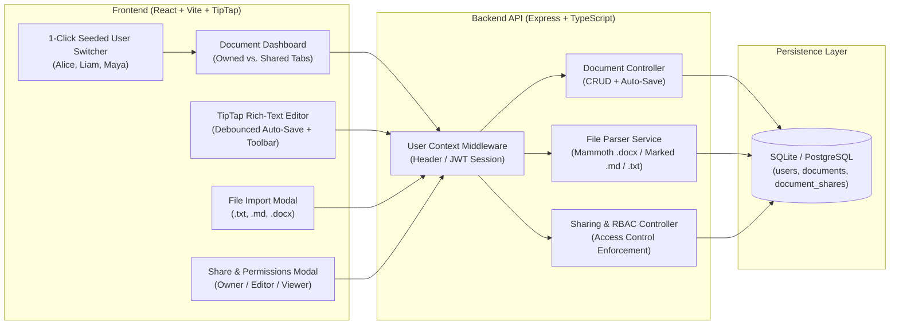
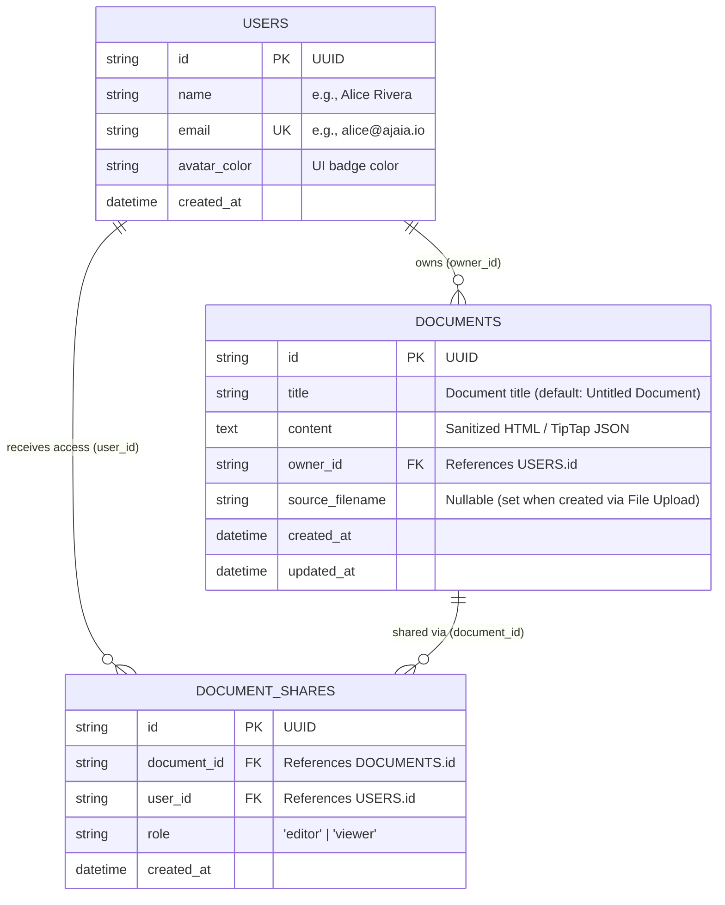

# AI-Native Full Stack Developer Assignment — Implementation Plan & Complete Specification Answers

> **Project Name:** **Ajaia Docs** — Lightweight Collaborative Document Workspace  
> **Target Timebox:** 4–6 Hours  
> **Workspace Layout:** `./Frontend` (React + TypeScript + TipTap) & `./Backend` (Node.js + Express + TypeScript + SQLite/Postgres)

---

## 1. Executive Summary & Product Philosophy

The objective of this assignment is not to clone every surface of Google Docs, but to ship a **high-craft, end-to-end working product slice** within a strict 4–6 hour window that demonstrates sound product judgment, reliable full-stack engineering, and disciplined AI-assisted execution.

### Core Product Thesis
Teams using internal productivity tools care most about three friction points:
1. **Zero-friction drafting & formatting:** Opening a document, writing with familiar rich-text shortcuts or toolbar controls, and trusting that work is persisted automatically without data loss.
2. **Bridging existing files into live docs:** Teams rarely start from a blank page—they import existing `.md`, `.txt`, or `.docx` notes and immediately turn them into collaborative living documents.
3. **Clear ownership & access boundaries:** Knowing immediately whether a document is *Owned by me* or *Shared with me*, who else has access, and whether a collaborator can edit or only view.

To make evaluation effortless for reviewers, **Ajaia Docs** includes a **1-Click Persona Switcher** in the top navigation bar (pre-seeded with 3 team members: *Alice Rivera*, *Liam Chen*, and *Maya Patel*) alongside standard login. Reviewers can share a document as Alice and switch to Liam in a single click to verify permissions (`Owner`, `Editor`, `Viewer`) in real time without creating throwaway email accounts.

---

## 2. Recommended Tech Stack & Justification

A unified **TypeScript** stack across `./Frontend` and `./Backend` maximizes delivery speed, eliminates context-switching overhead, and ensures end-to-end type safety within the 4–6 hour constraint.

| Layer | Technology | Why It Fits the 4–6 Hour Timebox |
| :--- | :--- | :--- |
| **Frontend Framework** | **React 18 + Vite + TypeScript** (`./Frontend`) | Instant HMR, clean component model, zero framework bloat, and trivial static/SPA deployment. |
| **Rich-Text Editor** | **TipTap (ProseMirror)** (`@tiptap/react`, `StarterKit`, `Underline`, `Placeholder`) | Headless, extensible, schema-driven editor. Natively supports Bold, Italic, Underline, H1–H3, Bullet & Ordered Lists, keyboard shortcuts (`Cmd+B`, `Cmd+I`, markdown prefixes like `# `, `- `), and serializes deterministically to HTML/JSON. |
| **Styling & UI** | **Tailwind CSS + Lucide Icons** | Rapid creation of a clean, Google Docs / Notion-inspired paper-canvas UI with responsive toolbars and accessible modals. |
| **Backend API** | **Node.js + Express + TypeScript** (`./Backend`) | Lightweight, predictable REST architecture with clean middleware composition for auth simulation, RBAC checks, and multipart file uploads. |
| **Database & Persistence** | **SQLite (`better-sqlite3` + Drizzle ORM / Prisma)** *(Postgres/Supabase ready)* | Zero external setup required for local review (`npm run dev` boots a pre-seeded database immediately), while supporting persistent disk on Render/Railway or a drop-in `DATABASE_URL` switch to Supabase/Neon Postgres. |
| **File Upload & Parsing** | **Multer + Mammoth (`.docx`) + Marked (`.md`)** | Converts uploaded `.docx`, `.md`, and `.txt` files directly into clean semantic HTML that loads seamlessly into the TipTap editor. |
| **Validation & Security** | **Zod + DOMPurify / `sanitize-html`** | Enforces strict schema validation on all API payloads and strips unsafe `<script>`/event attributes from uploaded or edited HTML. |
| **Automated Testing** | **Vitest + Supertest** | Fast, zero-flakiness integration tests verifying document CRUD, file import conversion, and sharing authorization boundaries. |
| **Deployment** | **Render / Railway** (Backend + SQLite Volume) + **Vercel** (Frontend) *or unified single-service deploy* | Free for reviewers to access with zero cold-start authentication barriers or paid dependencies. |

---

## 3. System Architecture & Data Model



### Database Schema



---

## 4. Detailed Feature Specifications (Answering All Core Tasks)

### Task 1: Document Creation and Editing
* **Capabilities Implemented:**
  * **Create:** "New Document" button creates a document titled `Untitled Document` and opens the editor immediately.
  * **Rename:** Inline editable title input in the document header; saves on blur or `Enter` with empty-title fallback to `Untitled Document`.
  * **Rich-Text Formatting Toolbar:**
    * **Text Styles:** Bold (`Cmd/Ctrl+B`), Italic (`Cmd/Ctrl+I`), Underline (`Cmd/Ctrl+U`).
    * **Typography / Size Variation:** Paragraph (`Normal`), Heading 1 (`H1`), Heading 2 (`H2`), Heading 3 (`H3`).
    * **Lists:** Bulleted List (`<ul>`) and Numbered List (`<ol>`).
    * **History & Ergonomics:** Undo (`Cmd/Ctrl+Z`), Redo (`Cmd/Ctrl+Shift+Z`), live word/character counter, and active toolbar button highlighting as the cursor moves.
  * **Save & Reopen Flow:**
    * **Dual Save UX:** Automatic debounced save (`800ms` after typing stops) paired with an explicit **"Save Now"** button (`Cmd/Ctrl+S`) and a live status indicator (`Saved just now`, `Saving...`, `Unsaved changes`, or `Error saving`).
    * **Reopen:** Clicking any document card on the dashboard fetches the persisted HTML/JSON structure and restores exact formatting.

### Task 2: File Upload
* **Chosen Product Behavior:**
  * We support **two high-value workflows** using a single unified upload pipeline:
    1. **"Upload File as New Document"** (from the Dashboard): Users upload a `.txt`, `.md`, or `.docx` file, and the system automatically parses its content, preserves headings/lists/bold formatting, sets the document title from the filename, and opens it as a new editable document.
    2. **"Import File into Current Document"** (from inside the Editor toolbar): Appends or replaces content in the active draft from an uploaded file.
* **Supported File Types & Constraints (Explicitly Stated in UI & README):**
  * **Supported Formats:** `.txt` (Plain Text), `.md` (Markdown), `.docx` (Microsoft Word).
  * **Max File Size:** `5 MB` per file.
  * **Conversion Pipeline:**
    * `.docx` → Parsed via `mammoth.convertToHtml()` to preserve headings, paragraphs, bold/italic, and lists.
    * `.md` → Parsed via `marked` into semantic HTML (`<h1>`–`<h3>`, `<ul>`, `<ol>`, `<strong>`, `<em>`).
    * `.txt` → Escaped and split on double-newlines into `<p>` blocks.
  * **UI & Validation:** Unsupported extensions (e.g., `.pdf`, `.exe`, `.png`) or files `>5MB` are rejected on both client and server with a clear, actionable toast message. Document cards imported from a file display an `Imported from <filename>` badge.

### Task 3: Sharing & Access Control
* **Ownership & Sharing Model:**
  * Every document has one immutable `owner_id`.
  * The owner can open the **Share Modal** inside any document (or from the dashboard card menu) and grant access to another user by selecting a team member or typing their email address.
  * **Role-Based Access (Core + Stretch):** Owners can grant either **Can Edit (`editor`)** or **Can View (`viewer`)** permissions, update roles at any time, or revoke access.
* **Visible Distinction in UI:**
  * **Dashboard Filter Tabs:**
    * `All Documents`
    * `Owned by Me` (displays an indigo **Owner** badge and share count)
    * `Shared with Me` (displays a green **Shared by [Owner Name]** badge and the user's permission badge: `Can Edit` or `View Only`)
  * **Editor Enforcement:**
    * If a user has `viewer` access, the TipTap editor mounts in `editable: false` mode, hides the formatting toolbar, and shows a clear `"Read-Only Mode (Shared by Alice)"` banner.
    * Backend `PATCH /api/documents/:id` and `DELETE /api/documents/:id` enforce permissions server-side (403 Forbidden if a `viewer` attempts to edit or a non-owner attempts to delete/change sharing settings).
* **Seeded Accounts for Instant Reviewer Testing:**
  * `alice@ajaia.io` — **Alice Rivera** (Product Lead)
  * `liam@ajaia.io` — **Liam Chen** (Staff Engineer)
  * `maya@ajaia.io` — **Maya Patel** (Product Designer)

### Task 4: Persistence
* **Storage Strategy:**
  * Relational persistence via **SQLite (`better-sqlite3`)** stored in `./Backend/data/ajaia.db` (with automatic schema initialization and seed data on first boot).
  * **Why SQLite:** Runs with zero external database dependencies locally (`npm install && npm run dev` works out of the box), uses WAL (Write-Ahead Logging) mode for fast concurrent reads/writes, and persists across server restarts and browser refreshes.
  * **Pre-Populated Demo State:** On initial boot, if the database is empty, the backend seeds 3 users and 3 realistic sample documents (including an owned product spec, a document shared with `Editor` access, and a document shared with `Viewer` access) so reviewers immediately see a rich product state.

### Task 5: Product and Engineering Quality
* **Validation & Error Handling:**
  * All API endpoints validate request bodies and query parameters using **Zod** schemas (`CreateDocSchema`, `UpdateDocSchema`, `ShareDocSchema`).
  * Standardized JSON error responses: `{ error: { code: string, message: string, details?: any } }`.
  * Frontend error boundaries and toast notifications for network failures, invalid file types, or unauthorized actions.
* **Automated Testing (`./Backend/tests/api.test.ts`):**
  * **Test Suite 1 — Document Lifecycle:** Creates a document, updates rich-text HTML content, reopens it, and verifies formatting tags (`<h1>`, `<strong>`, `<ul>`) persist intact.
  * **Test Suite 2 — Access Control & Sharing Security:** Verifies that User A can share a document with User B (`viewer`), User B can read it (`200 OK`), User B is blocked from modifying it (`403 Forbidden`), and unshared User C cannot access it at all (`403 Forbidden`).
  * **Test Suite 3 — File Upload & Conversion:** Uploads a sample `.md` and `.txt` buffer to `/api/documents/upload`, asserts `201 Created`, and verifies conversion into structured HTML paragraphs and headings.

### Optional Stretch Goals Selected
Without compromising core stability, we include **two high-leverage stretch enhancements** that take <30 minutes combined:
1. **Role-Based Sharing Permissions (`editor` vs. `viewer`):** Enforced both in the backend API and in the frontend editor state.
2. **1-Click Export to Markdown (`.md`) & Print/PDF:** Users can export any document out of Ajaia Docs cleanly from the editor header.

---

## 5. API Specification & Directory Structure

### REST API Endpoints (`./Backend`)

| Method | Endpoint | Description | Access Control |
| :--- | :--- | :--- | :--- |
| `GET` | `/api/users` | List seeded users for the 1-click account switcher & share autocomplete | Authenticated User |
| `GET` | `/api/documents?filter=all\|owned\|shared` | List documents accessible to current user (`x-user-id` header) | Owner or Collaborator |
| `POST` | `/api/documents` | Create a new blank or pre-filled document | Authenticated User |
| `POST` | `/api/documents/upload` | Upload `.txt`, `.md`, or `.docx` to create a new document or return HTML | Authenticated User |
| `GET` | `/api/documents/:id` | Get document content, metadata, owner info, and share list | Owner, Editor, or Viewer |
| `PATCH` | `/api/documents/:id` | Update title and/or rich-text content | Owner or Editor |
| `DELETE` | `/api/documents/:id` | Permanently delete a document | Owner Only |
| `POST` | `/api/documents/:id/shares` | Share document with another user (`email`/`userId`, `role`) | Owner Only |
| `DELETE` | `/api/documents/:id/shares/:shareId` | Revoke a user's access to a document | Owner Only |

### Project Directory Layout

```text
Ajaia/
├── Backend/
│   ├── src/
│   │   ├── db/
│   │   │   ├── database.ts        # SQLite connection, schema init, & idempotent seed
│   │   │   └── types.ts           # Database models (User, Document, DocumentShare)
│   │   ├── middleware/
│   │   │   ├── auth.ts            # Resolves active user from x-user-id header
│   │   │   └── errorHandler.ts    # Centralized Zod & HTTP error formatting
│   │   ├── routes/
│   │   │   ├── documents.ts       # Document CRUD, RBAC enforcement, & upload endpoint
│   │   │   ├── shares.ts          # Grant, update, and revoke document sharing
│   │   │   └── users.ts           # Seeded users endpoint for switcher & share picker
│   │   ├── services/
│   │   │   └── fileParser.ts      # Parses .txt, .md (marked), and .docx (mammoth) -> HTML
│   │   └── app.ts                 # Express app setup (exported for Supertest)
│   ├── tests/
│   │   └── documents.test.ts      # Automated integration tests (CRUD, RBAC, Upload)
│   ├── package.json
│   └── tsconfig.json
├── Frontend/
│   ├── src/
│   │   ├── api/
│   │   │   └── client.ts          # Typed API client injecting active user header
│   │   ├── components/
│   │   │   ├── Navbar.tsx         # Branding + 1-Click Persona Switcher
│   │   │   ├── Dashboard.tsx      # Owned/Shared tabs, search, New Doc & Upload triggers
│   │   │   ├── EditorView.tsx     # Document title, save indicator, TipTap canvas
│   │   │   ├── Toolbar.tsx        # Bold, Italic, Underline, H1-H3, Lists, Export/Import
│   │   │   ├── ShareModal.tsx     # Manage collaborators, roles (Editor/Viewer), & revoke
│   │   │   └── UploadModal.tsx    # Drag-and-drop .txt/.md/.docx uploader with validation
│   │   ├── App.tsx
│   │   └── main.tsx
│   ├── package.json
│   └── vite.config.ts
├── README.md                      # Local setup, seeded users, supported files, test guide
├── ARCHITECTURE.md                # Prioritization, tradeoffs, and system design note
├── AI_WORKFLOW.md                 # AI tools used, speedups, rejected outputs, verification
├── SUBMISSION.md                  # Deliverables checklist & live links (<1000 lines)
└── IMPLEMENTATION_PLAN.md         # This blueprint document
```

---

## 6. Answers to Required Written Deliverables

Below are the complete, ready-to-submit answers for the **Architecture Note**, **AI-Native Workflow Note**, **Walkthrough Video Script**, and **Submission Summary**.

---

### A. Architecture Note (`ARCHITECTURE.md`)

#### 1. What We Prioritized and Why
Within a 4–6 hour timebox, our highest priority was **end-to-end reliability across the four core product surfaces** (Rich-Text Editing, File Import, Access-Controlled Sharing, and Persistence) rather than superficial visual clone features:
* **Schema-Backed Rich Text over Raw `contenteditable`:** Calling `document.execCommand` on a raw `contenteditable` div leads to inconsistent HTML across browsers and broken nested lists. We prioritized **TipTap (ProseMirror)** so that Bold, Italic, Underline, Headings (H1–H3), and Lists produce clean, deterministic HTML that survives save/reload cycles intact.
* **Dual-Mode File Upload (`.docx`, `.md`, `.txt`):** Instead of storing opaque binary blobs that users can only download, we prioritized converting uploaded files directly into editable rich-text documents using `mammoth` (`.docx`) and `marked` (`.md`). This directly serves the core workflow of a collaborative docs tool.
* **Zero-Friction Reviewer Experience for Sharing:** Testing multi-user sharing flows often fails during review if evaluators must register multiple email accounts. We prioritized a **1-Click Persona Switcher** backed by real backend authorization (`x-user-id` session context + database RBAC table) so reviewers can experience `Owner`, `Editor`, and `Viewer` perspectives in seconds.
* **Debounced Auto-Save with Explicit Feedback:** Users expect modern cloud editors to save automatically without losing cursor position. We implemented an 800ms debounced save pipeline paired with an explicit `Cmd/Ctrl+S` save button and a live status badge (`Saved`, `Saving...`, `Unsaved changes`).

#### 2. Key Tradeoffs & What We Intentionally Deprioritized
* **Deprioritized WebSockets / CRDT Real-Time Co-Editing (Yjs):** While Yjs + WebSockets enables character-by-character live cursors, setting up a stateful WebSocket sync server alongside REST persistence within 4 hours introduces high risk of race conditions and deployment complexity. Instead, we opted for reliable REST auto-save + role-based sharing (`Editor` vs. `Viewer`) and clean optimistic UI updates.
* **Deprioritized Heavyweight OAuth / Magic Links:** Full Auth0/Clerk email verification slows down reviewer testing and introduces external service dependencies. Seeded accounts with a switching header allow full backend RBAC enforcement without external auth friction.
* **Deprioritized Page-Break Pagination Layout:** Simulating multi-page print pagination (`8.5" x 11"` canvas splits) in CSS is brittle and distracts from core editing. We chose a clean, continuous paper canvas inspired by Notion and Google Docs' "Pageless" mode.

---

### B. AI-Native Workflow Note (`AI_WORKFLOW.md`)

#### 1. Which AI Tools Were Used
* **Antigravity (Gemini 4 Argon / Agentic IDE Assistant):** Used for architectural planning, API contract scaffolding, database schema generation, and writing integration test suites.
* **TypeScript Language Server + Inline AI Completions:** Used for rapid component wiring, Tailwind CSS styling, and Zod validation schemas.

#### 2. Where AI Materially Sped Up Work
* **Boilerplate & CRUD Scaffolding (~60% time saved):** AI generated the initial Express route handlers, SQLite table initialization scripts, and typed frontend API client in minutes rather than an hour of manual typing.
* **File Parsing Pipeline (`.docx` & `.md` to TipTap HTML):** AI rapidly drafted the `fileParser.ts` service combining `mammoth` and `marked` with HTML sanitization rules, allowing us to support three distinct file formats cleanly.
* **Integration Test Generation:** AI accelerated writing comprehensive `supertest` assertions for multi-user sharing scenarios (verifying `200 OK` for owners/editors and `403 Forbidden` for viewers/unshared users).

#### 3. What AI-Generated Output Was Changed or Rejected (Judgment & Override Examples)
1. **Rejected: Uncontrolled TipTap `content` Prop Re-rendering (Cursor Jump Bug)**
   * *What AI suggested:* Passing `content={doc.content}` directly into `useEditor({ content })` with a reactive dependency array that re-initialized or called `editor.commands.setContent()` on every auto-save response.
   * *Why we rejected/changed it:* Calling `setContent()` when an auto-save HTTP response resolves resets the user's cursor to the end of the document while they are still typing. We modified the editor lifecycle so `setContent()` only fires when switching document IDs or importing a file, keeping typing latency at zero.
2. **Rejected: Client-Side-Only Sharing Filters**
   * *What AI suggested:* Returning all documents from `GET /api/documents` and filtering "Owned" vs. "Shared" in React `.filter()`.
   * *Why we rejected/changed it:* That leaks unauthorized documents over the network and fails basic security engineering standards. We enforced SQL `LEFT JOIN document_shares` filtering and server-side RBAC middleware (`requireDocAccess(minRole)`) on every read, write, and delete endpoint.
3. **Changed: Raw File Upload Storage vs. Content Extraction**
   * *What AI suggested:* Saving uploaded files to a `/uploads` static folder as binary attachments.
   * *Why we changed it:* In a document editor, uploading a `.md` or `.docx` file should turn it into an editable document. We redirected the implementation to parse file buffers in memory (`multer.memoryStorage()`) with a strict 5MB limit and sanitize the extracted HTML before storing it in the document body.

#### 4. How We Verified Correctness, UX Quality, and Implementation Reliability
* **Automated API & Security Tests:** Executed `vitest` + `supertest` suites verifying that unauthorized users and read-only viewers cannot mutate documents (`403 Forbidden`) even if they bypass the frontend UI.
* **Cross-Persona Manual UX Walkthrough:** Tested the complete lifecycle across all 3 seeded accounts (*Alice* creates and uploads a `.md` spec → formats with headings/lists → shares with *Liam* as `Editor` and *Maya* as `Viewer` → verifies *Liam* can edit and persist changes while *Maya* sees a locked read-only view → refreshes browser to confirm persistence).
* **Edge-Case Validation Checks:** Tested empty document titles, oversized files (`>5MB`), unsupported extensions (`.exe`, `.pdf`), and HTML injection payloads (`<script>alert(1)</script>`) to verify sanitization.

---

### C. Walkthrough Video Script (3–5 Minutes)

| Timestamp | Section | What to Show on Screen & Narrate |
| :--- | :--- | :--- |
| **0:00 – 0:40** | **1. Intro & Main User Flow** | Show the live deployed URL. Introduce **Ajaia Docs** and the 3 seeded team personas in the header (*Alice*, *Liam*, *Maya*). Click **"New Document"**, rename it inline, and demonstrate rich-text formatting (Bold, Italic, Underline, H1–H3, Bullet & Numbered Lists) with live auto-save status (`Saving...` → `Saved`). Refresh the browser to prove persistence. |
| **0:40 – 1:30** | **2. File Upload End-to-End** | Click **"Upload File"** on the dashboard. Show the explicit UI note listing supported formats (`.txt`, `.md`, `.docx` up to 5MB). Upload a `.md` or `.docx` file and show how it immediately converts into a formatted, editable document with an `Imported` badge. Also demonstrate rejecting an unsupported file type cleanly. |
| **1:30 – 2:30** | **3. Sharing & Access Control** | As *Alice* (Owner), open the **Share Modal** on the uploaded document. Grant *Liam* `Can Edit` access and *Maya* `View Only` access. Use the **1-Click Persona Switcher** to switch to *Liam* → go to the **"Shared with Me"** tab → edit the document and refresh. Then switch to *Maya* → show the **Read-Only Mode** banner and disabled toolbar. |
| **2:30 – 3:30** | **4. Prioritization & Deprioritized Scope** | Briefly show `ARCHITECTURE.md` and the codebase (`./Backend` & `./Frontend`). Explain why we prioritized TipTap schema-backed editing, in-memory file-to-HTML conversion, and server-side RBAC over fragile CRDT WebSockets or heavyweight third-party OAuth within the 4–6 hour window. |
| **3:30 – 4:15** | **5. AI Workflow & Verification** | Highlight `AI_WORKFLOW.md` and run `npm test` in the terminal. Explain how AI accelerated CRUD and `mammoth`/`marked` scaffolding, where we overrode AI (preventing TipTap cursor resets during auto-save and enforcing server-side SQL access control), and how automated tests verify security. |

---

### D. Submission & Deliverables Summary (`SUBMISSION.md` Template)

* ** What is Included in the Submission Folder:**
  1. `./Frontend` & `./Backend` — Full source code (TypeScript, React, TipTap, Express, SQLite).
  2. `README.md` — Local setup instructions, seeded user credentials, supported file types, and test commands.
  3. `ARCHITECTURE.md` — Short architecture note covering prioritization, system design, and scope tradeoffs.
  4. `AI_WORKFLOW.md` — Practical AI workflow note detailing tools used, speedups, rejected AI patterns, and verification.
  5. `SUBMISSION.md` — Complete index of deliverables, live deployment URL, and feature status.
  6. `walkthrough_video.txt` — Public/unlisted walkthrough video URL (Loom / YouTube).
  7. `./screenshots/` — Demo screenshots/GIFs of the editor, file upload, and multi-user sharing flow.

* **What is Working vs. Incomplete & Next 2–4 Hours Roadmap:**
  * **Working End-to-End:**
    * Document creation, inline renaming, deletion, and dashboard filtering (`All`, `Owned by Me`, `Shared with Me`).
    * Rich-text editing (Bold, Italic, Underline, H1–H3, Bullet & Numbered Lists, Undo/Redo) with 800ms auto-save + manual save.
    * File upload (`.txt`, `.md`, `.docx`) converting directly into new editable documents or importing into an active draft.
    * Multi-user sharing with `Owner`, `Editor`, and `Viewer` permissions enforced on both client and server, plus 1-Click Persona Switcher.
    * Full SQLite persistence across restarts/refreshes and automated backend integration tests.
  * **Intentionally Deprioritized / Partial:**
    * Real-time character-by-character concurrent editing (currently uses last-write-wins REST auto-save).
    * Granular inline text comments and full diff-based version history.
  * **What We Would Build Next with Another 2–4 Hours:**
    1. **Yjs + WebSocket Collaboration Provider (`y-websocket`):** Add live collaborator cursors and conflict-free concurrent editing on top of the existing TipTap schema.
    2. **Document Version Snapshots (`document_versions` table):** Automatically snapshot major saves and let owners preview or restore previous versions in a side drawer.
    3. **Inline Comment Threads:** Add a custom TipTap mark extension allowing `Viewer` and `Editor` collaborators to highlight text and leave anchored feedback threads.

---

## 7. 4–6 Hour Execution Timeline

| Time Block | Milestone | Key Deliverables |
| :--- | :--- | :--- |
| **Hour 0:00 – 0:45** | **1. Backend Core & Persistence** | Initialize `./Backend` (Express + TypeScript + SQLite), create `users`, `documents`, and `document_shares` tables, add startup seed script (Alice, Liam, Maya + sample docs). |
| **Hour 0:45 – 1:45** | **2. REST API, File Parser & RBAC** | Implement Document CRUD, Share endpoints, `fileParser.ts` (`.txt`, `.md`, `.docx` via `mammoth`/`marked`), and Zod validation. |
| **Hour 1:45 – 3:00** | **3. Frontend Editor & Dashboard** | Initialize `./Frontend` (React + Vite + Tailwind + TipTap), build Dashboard (`Owned` vs `Shared` tabs), TipTap Editor with formatting toolbar, and debounced auto-save. |
| **Hour 3:00 – 4:00** | **4. Upload, Share Modal & Switcher** | Build `UploadModal`, `ShareModal` (`Editor`/`Viewer` roles), and top-bar `PersonaSwitcher`. Connect end-to-end with backend. |
| **Hour 4:00 – 4:45** | **5. Automated Tests & Edge Cases** | Write and run `vitest` + `supertest` suite in `./Backend/tests/`, verify read-only mode, file size/type rejection, and HTML sanitization. |
| **Hour 4:45 – 5:30** | **6. Deployment & Documentation** | Deploy live build, finalize `README.md`, `ARCHITECTURE.md`, `AI_WORKFLOW.md`, `SUBMISSION.md`, and record the 3–5 minute Loom walkthrough. |
